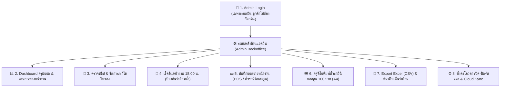

# เอกสารออกแบบระบบและ UI/UX (System & UI/UX Design Specification)
**โครงการ:** ระบบพรีออเดอร์โคมลอย และระบบจำหน่ายบัตรชมมินิบอลลูน — เทศกาลท่องเที่ยวเมืองพร้าว 2569 (Phrao Tourism Festival 2026)  
**สถานที่จัดงาน:** ณ โฮงชาฮักมี ต.แม่ปั๋ง อ.พร้าว จ.เชียงใหม่  
**ติดต่อสอบถาม:** 081-669-6653 (คุณฝ้าย)  
**ผู้พัฒนาระบบ:** **S.Y. Interactive Development Limited**

---

## 1. แนวคิดการออกแบบ (Design Concept & Theme)

### 1.1 อัตลักษณ์และบรรยากาศ (Mood & Tone)
* **Lanna Night Sky & Golden Lantern (สำหรับส่วนจองโคมลอย 24–25 พ.ย. 2569):**
  * โทนสีกรมท่าเข้มยามค่ำคืน (`#0B132B`, `#1C2541`) ตัดกับสีทองอำพันของแสงโคมลอย (`#F59E0B`, `#FBBF24`, `#FEF3C7`) ให้ความรู้สึกอบอุ่น มงคล และสื่อถึงประเพณีลอยกระทงล้านนา
* **Phrao Sunset & Nature Green (สำหรับส่วนชมมินิบอลลูน 20–21 พ.ย. 2569):**
  * โทนสีเขียวธรรมชาติเมืองพร้าว (`#2D4F38`, `#3B6E4C`) และสีครีมอ่อน (`#FAF6F0`) ผสานกับสีสันสดใสของมินิบอลลูนยามอาทิตย์อัสดง
* **หลักการสำคัญ (Core UX Principles):**
  1. **Mobile-First 100%:** ลูกค้าส่วนใหญ่เข้าเว็บผ่านสมาร์ทโฟนจากการสแกน QR Code หรือคลิกลิงก์โซเชียล ปุ่มกดต้องใหญ่ กดง่าย ตัวหนังสืออ่านชัดเจนแม้ผู้สูงอายุใช้งาน
  2. **No Customer Login Required:** ลูกค้าไม่ต้องสมัครสมาชิกหรือล็อกอินให้ยุ่งยาก กรอกข้อมูล -> สแกนจ่าย -> แนบสลิป -> รับ E-Ticket ได้ทันทีภายในหน้าเดียว
  3. **Zero-Error Resilience:** มีการตรวจสอบข้อมูล (Validation) ทุกช่องก่อนส่ง บีบอัดรูปสลิปอัตโนมัติไม่ให้เว็บค้าง และทำงานได้ลื่นไหล 100%

---

## 2. ระบบสีและฟอนต์ (Design System Tokens)

### 2.1 Color Palette
| ชื่อสี (Token) | รหัสสี (Hex) | การนำไปใช้งาน |
| :--- | :--- | :--- |
| `Primary Night` | `#0F172A` | พื้นหลังส่วน Hero โคมลอย และแถบหัวข้อหลัก |
| `Lantern Gold` | `#F59E0B` | ปุ่ม Action หลัก (จองโคมลอย), ไฮไลต์ราคา 299 บาท, ไอคอนมงคล |
| `Lantern Glow` | `#FEF3C7` | พื้นหลังการ์ดสิทธิพิเศษ / สิ่งที่ได้รับ |
| `Phrao Green` | `#2E4F36` | สีประจำเทศกาลท่องเที่ยวอำเภอพร้าว / ส่วนบัตรมินิบอลลูน |
| `Cream Paper` | `#FDFBF7` | พื้นหลังการ์ดและพื้นหลังตั๋วชมมินิบอลลูน |
| `Success Emerald` | `#10B981` | สถานะชำระเงินสำเร็จ / อนุมัติแล้ว / เช็คอินแล้ว |
| `Warning Amber` | `#D97706` | สถานะรอตรวจสอบสลิป |
| `Danger Rose` | `#EF4444` | ข้อความแจ้งเตือนข้อมูลไม่ครบ / ยกเลิกรายการ |

### 2.2 Typography
* **ฟอนต์หลัก (Thai & English):** `Prompt` และ `Sarabun` จาก Google Fonts
  * หัวข้อหลัก (Heading): `Prompt` (Bold 600–700) อ่านง่าย ทันสมัย
  * เนื้อหาและรายละเอียดตั๋ว (Body & Ticket): `Sarabun` / `Prompt` (Regular 400–500) คมชัดทั้งบนหน้าจอและเมื่อสั่งพิมพ์ลงกระดาษ A4

---

## 3. การออกแบบหน้าจอฝั่งลูกค้า (Customer UI Specification)

### 3.1 โครงสร้างหน้าแรก (Single-Page Seamless Flow)
1. **Top Navigation Bar:**
   * โลโก้/ชื่อเทศกาล: **"เทศกาลท่องเที่ยวเมืองพร้าว 2569 • โฮงชาฮักมี"**
   * ปุ่มสลับโหมดรวดเร็ว:
     * `🏮 จองโคมลอย (24-25 พ.ย.)`
     * `🎈 บัตรชมมินิบอลลูน (20-21 พ.ย.)`
     * `🎫 ค้นหาบัตรของฉัน`
     * `🔒 สำหรับเจ้าหน้าที่ (Admin)`

2. **Section 1: พรีออเดอร์ปล่อยโคมลอย (24–25 พฤศจิกายน 2569)**
   * **แบนเนอร์ประชาสัมพันธ์:** อ้างอิงภาพ [387004.jpg](file:///c:/Users/Chinchettha/Desktop/unfounded/387004.jpg)
   * **ป้ายราคาเด่นชัด:** **ราคาโคมละ 299 บาท / 2 ท่าน**
   * **การ์ด "สิ่งที่ได้รับ (ครบเซ็ตพร้อมปล่อยโคม)":**
     1. 🏮 โคมลอยไซส์ XL (1 โคม สำหรับ 2 ท่าน)
     2. 🔥 ไฟแช็ค
     3. 🕯️ เทียน
     4. 🖊️ ปากกา (สำหรับเขียนคำอธิษฐานบนโคม)
     5. 🥤 เครื่องดื่ม
     6. 🎁 ของที่ระลึก
   * **การ์ดกำหนดการ:**
     * 🕕 **18.00 น.** — ลงทะเบียนรับโคมลอยและของที่ระลึก ณ โฮงชาฮักมี
     * 🕗 **20.00 น.** — ร่วมปล่อยโคมลอยพร้อมกัน
   * **ฟอร์มสั่งจองโคมลอย (3 ขั้นตอนง่ายๆ ในหน้าเดียว):**
     * **ขั้นที่ 1 เลือกวันและจำนวนโคม:**
       * ปุ่มเลือกวัน (การ์ดกดเลือก):
         * `[ อังคารที่ 24 พฤศจิกายน 2569 ]`
         * `[ พุธที่ 25 พฤศจิกายน 2569 ]`
       * ตัวเลือกจำนวนโคม: ปุ่ม `[-]` `1` `[+]` (คำนวณอัตโนมัติ: `จำนวน X โคม (สำหรับ 2X ท่าน) = ยอดชำระ X * 299 บาท`)
     * **ขั้นที่ 2 ข้อมูลผู้จอง:**
       * ชื่อ - นามสกุล หรือ ชื่อเล่น (จำเป็น)
       * เบอร์โทรศัพท์ 10 หลัก (จำเป็น — ใช้ค้นหาบัตรย้อนหลังได้)
       * หมายเหตุเพิ่มเติม (ถ้ามี)
     * **ขั้นที่ 3 ชำระเงินและแนบสลิป:**
       * แสดงยอดเงินรวมตัวเลขขนาดใหญ่ พร้อมปุ่มคัดลอกยอดเงิน
       * แสดงภาพ [QR Code.jpg](file:///c:/Users/Chinchettha/Desktop/unfounded/QR%20Code.jpg) (Thai QR Payment / PromptPay ธนาคารกรุงไทย)
       * ชื่อบัญชี: **น.ส.กนกพิชญ์ ชัยชมภู** (มีปุ่ม **"บันทึกรูป QR Code"** เพื่อนำไปเปิดในแอปธนาคารได้สะดวก)
       * กล่องอัปโหลดรูปสลิปโอนเงิน (แสดงรูป Preview ทันทีเมื่อเลือกไฟล์)
       * ปุ่มยืนยัน: **`ยืนยันการจองและรับบัตร E-Ticket`**

3. **Section 2: จอง/ซื้อบัตรชมมินิบอลลูนออนไลน์ (20–21 พฤศจิกายน 2569)**
   * แสดงภาพโปสเตอร์วันงาน [384855_0.jpg](file:///c:/Users/Chinchettha/Desktop/unfounded/384855_0.jpg), [384856_0.jpg](file:///c:/Users/Chinchettha/Desktop/unfounded/384856_0.jpg) และภาพมินิบอลลูน [บอลลูนตาหมากรุกเหนือทุ่งยามอาทิตย์อัสดง.png](file:///c:/Users/Chinchettha/Desktop/unfounded/บอลลูนตาหมากรุกเหนือทุ่งยามอาทิตย์อัสดง.png), [บอลลูนวัวยักษ์เหนือนาทุ่ง.png](file:///c:/Users/Chinchettha/Desktop/unfounded/บอลลูนวัวยักษ์เหนือนาทุ่ง.png)
   * รายละเอียดกิจกรรม:
     * **วันศุกร์ที่ 20 พ.ย. 2569:** ชมมินิบอลลูน & ดนตรี วงทุลักทุเล, สินค้าชุมชน, ดนตรี รร.พร้าว, ล่องเรือชมต้นฉำฉา, เดินป่าโมอาย, เครื่องดื่มและดนตรีสดช่วงเย็น
     * **วันเสาร์ที่ 21 พ.ย. 2569:** พิธีเปิด & Chef's Table อาหารล้านนา, การแสดง รร.แม่ปั๋ง, กลองสะบัดชัย • ฟ้อนรำ, การแสดงพื้นถิ่น
     * **เวลา:** 18.00 – 20.00 น. | **ราคา:** คนละ 100 บาท
   * ฟอร์มซื้อบัตรล่วงหน้า (เลือกวันที่ 20 หรือ 21 พ.ย., ระบุจำนวนท่านละ 100 บาท, สแกน QR เดียวกันและแนบสลิป รับ E-Ticket ทันที)

4. **Section 3: หน้าแสดง E-Ticket และค้นหาบัตรด้วยเบอร์โทร**
   * ดีไซน์เป็นบัตรดิจิทัลสวยงาม มี:
     * รหัสอ้างอิงการจอง (เช่น `KL24-0001` สำหรับโคมลอย หรือ `MB20-0001` สำหรับมินิบอลลูน)
     * QR Code ประจำบัตร (สำหรับเจ้าหน้าที่สแกนหน้างาน)
     * ชื่อผู้จอง, เบอร์โทร, วันที่เข้าร่วม, จำนวนโคม/จำนวนท่าน, ยอดชำระเงิน
     * ป้ายสถานะ: `รอตรวจสอบสลิป (ใช้ยื่นหน้างานได้)` หรือ `อนุมัติแล้ว (ยืนยันสมบูรณ์)` หรือ `เช็คอินรับโคมแล้ว`
     * ปุ่ม **ดาวน์โหลดบัตรเป็นรูปภาพ (PNG)** และปุ่ม **พิมพ์บัตร**

---

## 4. การออกแบบตั๋วชมมินิบอลลูนแบบแมนนวล (Manual Bus-Ticket Style Print Layout)

ตามความต้องการข้อ 4 และ 6:
> *"ขอทำไฟล์ จำหน่ายบัตรชมมินิบอลลูน คนละ 100 บาท เทศกาลท่องเที่ยวเมืองพร้าว วันที่ 20-21 พฤศจิกายน 2569 เวลา 18.00 - 20.00 น. ณ โฮงชาฮักมี ต.แม่ปั๋ง อ.พร้าว จ.เชียงใหม่ จะทำตั๋วแบบแมนนวลครับ ขายหน้างาน แบบตั๋วรถ"*

### 4.1 โครงสร้างตั๋วกระดาษ 1 ใบ (ต้นขั้ว + เส้นปรุฉีก + หางตั๋วลูกค้า)
```text
+-----------------------+-------------------------------------------------------+
| [ต้นขั้วสำหรับคนขาย]   |               [บัตรสำหรับลูกค้า (ฉีกให้ลูกค้า)]             |
|                       |  🎈 เทศกาลท่องเที่ยวเมืองพร้าว (PHRAO FESTIVAL 2026)    |
| เลขที่: NO. 0001       |  บัตรชมมินิบอลลูน (MINI BALLOON TICKET)                 |
|                       |  วันที่: 20 - 21 พฤศจิกายน 2569 | เวลา: 18.00 - 20.00 น.|
| บัตรชมมินิบอลลูน       |  ณ โฮงชาฮักมี ต.แม่ปั๋ง อ.พร้าว จ.เชียงใหม่               |
| ราคา 100 บาท          |  [ ] ศุกร์ 20 พ.ย. 69   [ ] เสาร์ 21 พ.ย. 69             |
| [ ] 20 พ.ย. [ ] 21 พ.ย.|  ---------------------------------------------------  |
| ผู้ขาย/วันที่:..........|  ราคาบัตร: 100 บาท / 1 ท่าน           เลขที่: NO. 0001  |
+-----------------------+-------------------------------------------------------+
                        ^ เส้นปะสำหรับฉีก / เย็บเล่มเหมือนตั๋วรถเมล์-ตั๋วงานวัด
```

### 4.2 คุณสมบัติของระบบสร้างไฟล์พิมพ์ตั๋ว (Ticket Print Studio)
* จัดวางลงกระดาษ **A4 แนวตั้ง (Portrait)** จำนวน **10 ใบต่อ 1 หน้า A4** (2 คอลัมน์ × 5 แถว) หรือ **8 ใบต่อหน้า** แบบไร้ขอบล้น พิมพ์แล้วตัดเย็บเป็นเล่มฉีกขายหน้างานเหมือนตั๋วรถได้ทันที
* เลือกรูปแบบได้:
  1. **แบบรวมวันที่ (20-21 พฤศจิกายน 2569)** พร้อมช่องทำเครื่องหมาย `[ ] 20 พ.ย.` / `[ ] 21 พ.ย.`
  2. **แบบแยกเล่มเฉพาะวันศุกร์ที่ 20 พ.ย. 2569** (สีเขียว-ทอง)
  3. **แบบแยกเล่มเฉพาะวันเสาร์ที่ 21 พ.ย. 2569** (สีน้ำเงินคราม-ส้มตะวัน)
* ตั้งค่าเลขรันนัมเบอร์ได้อิสระ (เช่น เริ่มต้น `0001` ถึง `0100`, `0101` ถึง `0500`)
* มีภาพพื้นหลังลายน้ำจางๆ จากรูปมินิบอลลูน ([บอลลูนตาหมากรุกเหนือทุ่งยามอาทิตย์อัสดง.png](file:///c:/Users/Chinchettha/Desktop/unfounded/บอลลูนตาหมากรุกเหนือทุ่งยามอาทิตย์อัสดง.png) และ [บอลลูนวัวยักษ์เหนือนาทุ่ง.png](file:///c:/Users/Chinchettha/Desktop/unfounded/บอลลูนวัวยักษ์เหนือนาทุ่ง.png)) ที่ช่วยให้ตั๋วดูสวยงามและป้องกันการปลอมแปลง แต่ยังอ่านตัวอักษรชัดเจน 100%

---

## 5. การออกแบบหน้ารายงานและระบบหลังบ้านของแอดมิน (Admin Backoffice & Reporting Specification)

ระบบหลังบ้านถูกออกแบบให้ครอบคลุมงานบริหารจัดการตั้งแต่ **ก่อนวันงาน (รับพรีออเดอร์/ตรวจสลิป/พิมพ์ตั๋วรถ)**, **ระหว่างวันงาน (สแกนเช็คอินรับโคม 18.00 น./ป้องกันการรับซ้ำ/บันทึกขายหน้างาน)** ไปจนถึง **หลังจบงาน (สรุปบัญชีรายได้/ส่งออก Excel)** โดยแบ่งออกเป็น **8 โมดูลหลัก** ดังนี้:



### 5.1 โมดูลที่ 1: ระบบเข้าสู่ระบบและความปลอดภัย (Admin Authentication)
* **เข้าถึงเฉพาะเจ้าหน้าที่:** มีปุ่ม `สำหรับเจ้าหน้าที่ (Admin)` ที่มุมบนขวาและท้ายเว็บ ล็อกอินด้วยรหัสผ่านแอดมิน (ลูกค้าทั่วไปไม่ต้องล็อกอิน)
* **เปลี่ยนรหัสผ่านได้เอง:** แอดมินสามารถเปลี่ยนรหัสผ่านใหม่ได้ในเมนูตั้งค่า

### 5.2 โมดูลที่ 2: แดชบอร์ดสรุปภาพรวม & คำนวณของที่ต้องเตรียม (Executive Dashboard & Inventory Calculator)
1. **การ์ดสรุปรายได้และจำนวนผู้เข้าร่วมแบบ Real-time (6 การ์ดหลัก):**
   * 💰 **รายได้รวมทั้งเทศกาล (บาท):** แสดงยอดรวมสุทธิ พร้อมแยกย่อย `อนุมัติแล้ว (บาท)`, `รอตรวจสลิป (บาท)`, และ `ขายหน้างาน (บาท)`
   * 🏮 **ยอดจองโคมลอย อังคารที่ 24 พ.ย. 2569:** จำนวนโคม (ลูก) / จำนวนผู้เข้าร่วม (`โคม × 2 ท่าน`) / ยอดเงินรวม (บาท) / โควตาคงเหลือ
   * 🏮 **ยอดจองโคมลอย พุธที่ 25 พ.ย. 2569:** จำนวนโคม (ลูก) / จำนวนผู้เข้าร่วม (`โคม × 2 ท่าน`) / ยอดเงินรวม (บาท) / โควตาคงเหลือ
   * 🎈 **ยอดบัตรชมมินิบอลลูน ศุกร์ที่ 20 พ.ย. 2569:** จำนวนบัตร (ออนไลน์ + ขายตั๋วรถหน้างาน) / ยอดเงินรวม (บาท)
   * 🎈 **ยอดบัตรชมมินิบอลลูน เสาร์ที่ 21 พ.ย. 2569:** จำนวนบัตร (ออนไลน์ + ขายตั๋วรถหน้างาน) / ยอดเงินรวม (บาท)
   * ✅ **ความคืบหน้าการลงทะเบียนหน้างาน (Check-in 18.00 น.):** มารับโคมแล้วกี่โคม / ยังไม่มารับกี่โคม
2. **ตารางคำนวณสิ่งของที่สตาฟต้องจัดเตรียมหน้างานอัตโนมัติ (Event Preparation Checklist):**
   * คำนวณตามยอดจองจริงของวันที่ 24 และ 25 พ.ย. 2569 เพื่อให้ทีมงานเตรียมของไม่ขาดตกบกพร่อง:
     * โคมลอยไซส์ XL = `N` ลูก
     * ไฟแช็ค = `N` อัน | เทียน = `N` เล่ม | ปากกา = `N` ด้าม
     * เครื่องดื่ม & ของที่ระลึก = แสดงจำนวนชุด (`N` ชุดโคม / สำหรับผู้เข้าร่วม `2N` ท่าน)

### 5.3 โมดูลที่ 3: ระบบตรวจสลิปโอนเงิน & จัดการแก้ไขรายการจอง (Slip Inspector & Booking Manager)
* **การค้นหาและกรองข้อมูล (Smart Search & Filters):**
  * ค้นหาด่วนด้วย **ชื่อลูกค้า, เบอร์โทรศัพท์, หรือรหัสจอง (`KL24-XXXX`, `MB20-XXXX`)**
  * ปุ่มกรองตามวัน (`ทั้งหมด`, `โคมลอย 24 พ.ย.`, `โคมลอย 25 พ.ย.`, `มินิบอลลูน 20 พ.ย.`, `มินิบอลลูน 21 พ.ย.`)
  * ปุ่มกรองตามสถานะ (`⏳ รอตรวจสลิป`, `✅ อนุมัติแล้ว`, `🏮 เช็คอินรับโคมแล้ว`, `❌ ยกเลิก/สลิปไม่ถูกต้อง`)
* **หน้าต่างตรวจสลิป (Slip Verification Modal):**
  * กดดูรูปสลิปขนาดใหญ่ชัดเจน เทียบกับยอดเงินที่ต้องชำระ (เช่น `2 โคม = 598 บาท` โอนเข้าบัญชี **น.ส.กนกพิชญ์ ชัยชมภู**)
  * ปุ่มกดเปลี่ยนสถานะในคลิกเดียว: **`✅ อนุมัติสลิป (Approve)`**, **`⏳ รอตรวจสอบ`**, **`❌ ปฏิเสธ/ยกเลิก`**
* **การแก้ไขข้อมูลและส่งบัตรให้ลูกค้า (Edit & Re-issue E-Ticket):**
  * แอดมินสามารถ **แก้ไขชื่อ, เบอร์โทร, เปลี่ยนวันที่ (เช่น ลูกค้าขอเลื่อนจาก 24 เป็น 25 พ.ย.), ปรับจำนวนโคม หรือเพิ่มหมายเหตุ** ได้
  * แอดมินสามารถกดปุ่ม **`🎫 ดู/บันทึก E-Ticket ของลูกค้ารายนี้`** เพื่อส่งรูปบัตรให้ลูกค้าทาง LINE หรือ Facebook ได้ทันที

### 5.4 โมดูลที่ 4: ระบบเช็คอินรับโคมหน้างาน เวลา 18.00 น. (On-site QR Check-in & Anti-Duplicate Guard)
* **ค้นหาด่วนหรือสแกน QR Code หน้างาน:**
  * เมื่อลูกค้ามาที่จุดลงทะเบียน ณ โฮงชาฮักมี เวลา 18.00 น. สตาฟสามารถสแกน QR Code บน E-Ticket หรือพิมพ์เบอร์โทร 4 ตัวท้าย
* **การป้องกันการรับโคมซ้ำ 100% (Anti-Duplicate Check-in):**
  * เมื่อกด **`🏮 ยืนยันส่งมอบโคมลอย (Check-in)`** ระบบจะบันทึกสถานะและเวลาที่รับของทันที (เช่น `รับโคมแล้วเมื่อ 24 พ.ย. 18:14 น.`)
  * หากมีการนำรูป E-Ticket เดิมมาสแกนซ้ำ ระบบจะขึ้นแจ้งเตือนสีแดงทันทีว่า **"⚠️ รหัสจองนี้รับโคมลอยไปแล้ว!"**

### 5.5 โมดูลที่ 5: ระบบบันทึกยอดขายหน้างาน / POS (Walk-in & Manual Ticket Logger)
* **บันทึกยอดขายตั๋วรถชมมินิบอลลูนหน้างาน (100 บาท):**
  * สำหรับตั๋วกระดาษแบบตั๋วรถที่ฉีกขายหน้างาน แอดมินสามารถบันทึกสรุปยอดรายวันหรือรายเล่มได้ทันที เช่น:
    * เลือกวันที่ (`20 พ.ย. 69` หรือ `21 พ.ย. 69`)
    * กรอกเลขต้นขั้วตั๋วที่ขายไป เช่น `NO. 0001` ถึง `NO. 0065` (ระบบคำนวณอัตโนมัติ = `65 ใบ / 6,500 บาท`) หรือกรอกจำนวนใบโดยตรง
    * เลือกวิธีรับเงิน (`เงินสดหน้างาน` หรือ `โอนสแกน QR หน้างาน`) แล้วกดบันทึกเพื่อให้ยอดรวมในหน้ารายงานแอดมินครบถ้วน 100%
* **บันทึกขายโคมลอยหน้างาน (Walk-in Lantern POS):**
  * กรณีลูกค้าเดินมาซื้อโคมลอยที่หน้างานโดยไม่ได้จองล่วงหน้า แอดมินกดเพิ่มรายการขายหน้างานเพื่อตัดสต็อกโคมและออก E-Ticket/ใบเสร็จได้ทันที

### 5.6 โมดูลที่ 6: สตูดิโอสร้างและสั่งพิมพ์ตั๋วรถชมมินิบอลลูน 100 บาท (Ticket Print Studio)
* เชื่อมต่อโดยตรงในหน้าแอดมิน (และเปิดแยกหน้าเต็มจอได้) สำหรับสร้างไฟล์พิมพ์ตั๋วชมมินิบอลลูน คนละ 100 บาท (20–21 พ.ย. 2569 เวลา 18.00–20.00 น. ณ โฮงชาฮักมี)
* ตั้งค่าเลขรันนัมเบอร์เริ่มต้น–สิ้นสุด, เลือกรูปแบบวัน, เลือกภาพบอลลูนประกอบ และสั่งพิมพ์ลงกระดาษ A4 (มีต้นขั้ว + เส้นปรุฉีก + หางตั๋ว) ได้ไม่จำกัดจำนวนเล่ม

### 5.7 โมดูลที่ 7: การส่งออกไฟล์ Excel & พิมพ์ใบลงทะเบียนหน้างาน (Export & Printable Reports)
* **`📥 Export Excel (CSV)`:** ดาวน์โหลดตารางข้อมูลทั้งหมดเป็นไฟล์ `.csv` เข้ารหัส UTF-8 BOM เปิดในโปรแกรม Microsoft Excel อ่านภาษาไทยได้สมบูรณ์ 100%
* **`🖨️ พิมพ์ใบรายชื่อลงทะเบียนหน้างาน (Print Registration Check-in Sheet A4)`:** สร้างตารางรายชื่อผู้จองโคมลอยแยกตามวัน (24 พ.ย. / 25 พ.ย.) พร้อมช่องว่างให้ลูกค้าเซ็นชื่อตอนมารับโคมลอยที่โต๊ะลงทะเบียนเวลา 18.00 น.
* **`🖨️ พิมพ์ใบสรุปยอดผู้บริหาร (Print Executive Financial Report A4)`:** พิมพ์ใบสรุปยอดขายและจำนวนผู้เข้าร่วมแยกตามกิจกรรมในหน้าเดียว

### 5.8 โมดูลที่ 8: การตั้งค่าระบบ โควตา และฐานข้อมูล (System, Quota & Cloud Settings)
* **จัดการโควตาและเปิด-ปิดรับจอง (Quota & Sold-Out Control):**
  * กำหนดจำนวนโคมสูงสุดต่อวัน (เช่น วันละ 200 โคม หรือไม่จำกัด)
  * สวิตช์เปิด-ปิดการรับจองออนไลน์แยกแต่ละวันได้ทันที (เช่น ปิดรับจองวันที่ 24 พ.ย. เมื่อโคมเต็ม แต่ยังเปิดวันที่ 25 พ.ย. ต่อได้)
* **จัดการข้อมูลและ Cloud Sync:**
  * ตั้งค่าการเชื่อมต่อฐานข้อมูลคลาวด์ (Supabase / Firebase URL & Key) เพื่อให้ข้อมูลซิงค์ข้ามเครื่องแบบ Real-time
  * ปุ่ม **สำรองข้อมูลทั้งหมดเป็นไฟล์ (Backup JSON)** และ **กู้คืนข้อมูล (Restore JSON)** เพื่อความปลอดภัยของข้อมูล 100%

---

## 6. โครงสร้างข้อมูลและการเชื่อมต่อ Supabase (Database Schema & Supabase Integration)

* **Supabase Project Ref:** `mpsuumkyqweenvdkmwwf`
* **Supabase Project URL:** `https://mpsuumkyqweenvdkmwwf.supabase.co`
* **ไฟล์ SQL โครงสร้างตาราง:** [supabase_schema.sql](file:///c:/Users/Chinchettha/Desktop/unfounded/supabase_schema.sql) (`public.bookings` และ `public.festival_settings`)

```json
{
  "id": "KL24-1001",
  "category": "lantern",
  "eventDate": "2026-11-24",
  "customerName": "คุณสมชาย ใจดี",
  "phone": "0812345678",
  "quantity": 2,
  "attendees": 4,
  "unitPrice": 299,
  "totalAmount": 598,
  "paymentMethod": "promptpay_qr",
  "slipDataUrl": "data:image/jpeg;base64,...",
  "paymentStatus": "approved",
  "checkedIn": false,
  "checkedInAt": null,
  "channel": "online",
  "note": "",
  "createdAt": "2026-11-17T08:15:00.000Z"
}
```
* **`category`:** `"lantern"` (โคมลอย 299 บาท/2 ท่าน) หรือ `"balloon"` (บัตรชมมินิบอลลูน 100 บาท/ท่าน)
* **`eventDate`:** `"2026-11-24"`, `"2026-11-25"` (สำหรับโคมลอย) หรือ `"2026-11-20"`, `"2026-11-21"` (สำหรับมินิบอลลูน)
* **`paymentStatus`:** `"pending"` (รอตรวจสลิป), `"approved"` (อนุมัติแล้ว), `"rejected"` (สลิปไม่ถูกต้อง/ยกเลิก)
* **`channel`:** `"online"` (จองผ่านเว็บ) หรือ `"walkin"` (ขายตั๋วแมนนวลหน้างาน)
